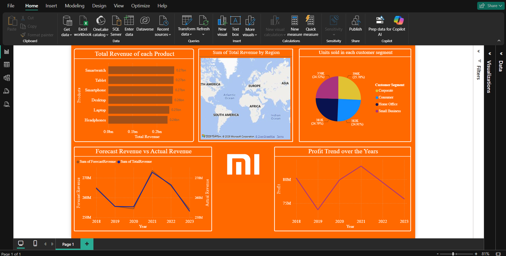

# Global Electronics Sales Analysis

A sales analytics project developed in April 2025 for the DASHWIZ Power BI Competition, where it secured First Place. The competition was held as part of CELISTA '25, a National-Level Technical Symposium at Meenakshi Sundararajan Engineering College, Chennai.

## Project Overview

The project focuses on analysing global electronics sales data and presenting sales information through a Power BI dashboard.

The competition organisers provided an Excel dataset containing order details, products, regions, customer segments, revenue, costs, profit and forecast revenue. The task was to analyse this information and present the key findings through clear visualisations.

## Problem Statement

The dataset contained sales information across different products, regions and customer segments. Understanding overall sales performance required looking at several aspects of the data, including revenue, profit, units sold and forecast revenue.

The objective was to analyse the supplied data and develop a dashboard that makes these business metrics easier to understand and compare.

## Solution

A Power BI dashboard was developed using the competition-provided Excel dataset. It brings together key sales metrics in one report and presents them through five analytical visuals.

The dashboard allows users to explore product performance, regional revenue, customer segments, profit trends and the comparison between actual and forecast revenue.

## Dashboard Preview



## Dashboard Overview

The report contains five analytical visuals:

| Analysis | Description |
|---|---|
| Revenue by Product | Compares total revenue across products. |
| Profit Trend | Shows profit trends from 2018 to 2023. |
| Revenue by Region | Presents total revenue across sales regions. |
| Units Sold by Customer Segment | Compares units sold across customer segments. |
| Actual vs Forecast Revenue | Compares actual revenue with forecast revenue. |

## Tech Stack

| Technology | Purpose |
|---|---|
| Power BI | Data visualisation and dashboard development |
| Excel | Working with the supplied sales dataset |

## Key Insights

- **Product Performance:** Smartwatch generated the highest revenue at 271.83 million, while Headphones recorded the lowest at 244.31 million.
- **Regional Performance:** Africa recorded the highest revenue at 282.13 million, while Oceania had the lowest at 246.81 million.
- **Customer Segments:** Corporate customers accounted for the highest number of units sold, with 395,583 units.
- **Profit Trends:** Annual profit peaked in 2021 at 82.79 million and reached its lowest point in 2019 at 73.65 million.
- **Revenue Forecast:** Total actual and forecast revenue were nearly equal across 2018–2023, differing by just 3,564.21.

## Dataset

The dataset was provided by the competition organisers.

The Excel workbook contains 3,000 data rows, 13 columns and one worksheet named `Sheet1`. The recorded order dates range from 3 January 2018 to 27 December 2023.

The dataset includes information about:

- Orders and order dates
- Regions and countries
- Products and categories
- Customer segments
- Units sold and unit prices
- Total revenue and cost of goods sold
- Profit and forecast revenue

The dataset covers six products, six regions and four customer segments.

For descriptions of all 13 columns, refer to the [Data Dictionary](docs/data-dictionary.md).

## Data Validation

The dataset was checked for basic data quality and numerical consistency.

The following checks were performed:

- Blank-cell verification.
- Duplicate `OrderID` verification.
- `UnitsSold × UnitPrice = TotalRevenue`.
- `TotalRevenue − COGS = Profit`.

No blank cells or duplicate `OrderID` values were found. Both numerical relationships were consistent across the dataset, within a tolerance of 0.01.

## Project Structure

```text
Global Electronics Sales Analysis/
├── LICENSE
├── .gitignore
├── README.md
├── assets/
│   └── dashboard-preview.png
├── dashboard/
│   └── global-electronics-sales.pbix
├── data/
│   └── global-electronics-sales-data.xlsx
└── docs/
    └── data-dictionary.md
```

## Getting Started

### Requirements

- Power BI Desktop
- Excel

### Open the Power BI Report

1. Clone or download the repository.
2. Open `dashboard/global-electronics-sales.pbix` in Power BI Desktop.
3. If prompted, reconnect the data source to `data/global-electronics-sales-data.xlsx`.
4. Refresh the data if required.
5. Explore the dashboard and its visualisations.

## Documentation

- [Data Dictionary](docs/data-dictionary.md) – descriptions of the dataset columns and their meanings.
